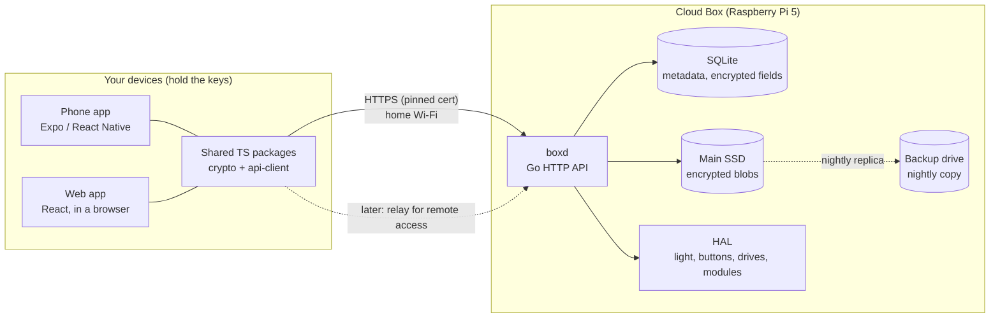

# 1. Architecture

The box is a storage server that only ever handles encrypted data. The apps
do all the encrypting, decrypting, thumbnailing and searching.

## Components

| Component | Language | Job |
|-----------|----------|-----|
| `boxd` | Go | HTTP API, auth, storage, replication, health, update agent |
| HAL | Go | Status light, power button, drive health, module detect and check |
| `@cloudbox/crypto` | TypeScript | Key derivation, file encryption, metadata encryption, sharing keys |
| `@cloudbox/api-client` | TypeScript | Typed client generated from `api/openapi.yaml` |
| Web app | React + Vite | Setup, browsing, files, box settings; served by `boxd` |
| Phone app | Expo | Pairing, automatic photo backup, browsing, free up space |
| Relay (later) | Go | Forwards encrypted traffic when not on home Wi-Fi |

## Key flows

**Photo backup (phone → box)**
1. App finds new photos in the phone library.
2. App makes a thumbnail and preview, reads date and location.
3. App encrypts original, preview, thumbnail and metadata with a fresh file key.
4. App uploads the encrypted blobs in resumable chunks.
5. Box stores blobs, checks the hash, records the item, replies with its id.
6. Nightly, the box copies new blobs to the backup drive and marks them replicated.
7. App shows "safe" only after steps 5 and 6 are done.

**Browsing**
1. App asks for changes since its last sync cursor.
2. Box returns encrypted item records.
3. App decrypts metadata into a local index (dates, places, names) and
   builds the timeline and search from that index.
4. Thumbnails download and decrypt on demand.

**Free up phone space**
App removes a photo from the phone only when the box reports the item as
stored, verified and replicated. The box copy is never touched.

## What runs where

| Concern | Where | Why |
|---------|-------|-----|
| Thumbnails, previews | Client | Box can't read images |
| Search, map, timeline | Client, from the local index | Metadata is encrypted |
| Duplicate and blurry detection | Client | Same |
| Storage, replication, quotas, trash purge | Box | Works on ciphertext |
| Safety status | Box computes, client shows | Box knows what's stored and copied |
